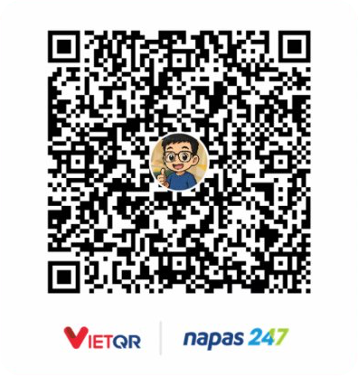

# Mõ Mõ · A quiet room

A small ambient page: an orange chibi cat tapping a wooden temple block in a warm Japanese room. Designed for a full-screen TV or monitor.

## Features

- A transparent cat video over a full-screen room picture; the mallet strikes three times every two seconds (90 BPM).
- The knock sound follows the video clock, so it lands on the frame where the mallet hits. Real recorded mokugyo audio, muted until you turn it on.
- Icon-only controls for sound, pause, the GitHub source, Ko-fi support and fullscreen; Space toggles pause, and the controls fade after inactivity.
- Falling autumn leaves, a screen wake lock while it plays, and a still cat when "reduce motion" is on.
- Scales from phones to 4K, and recovers by itself when the browser stalls the video or resets the GPU.

## Requirements

A current browser with WebGL and H.264 video. There is no build step and no dependency.

## Run locally

```sh
python3 -m http.server 8000 --directory public
```

Open http://localhost:8000.

## Guides

- [Architecture](docs/architecture.md): how the page is drawn, how the strike and sound stay in sync, stall recovery and the known Edge issue.
- [Deployment](docs/deployment.md): Vercel setup and Analytics.
- [Assets](docs/assets.md): how the cat clip was produced, and audio credits.
- [Decisions](docs/decisions.md): non-obvious choices and what was tried and dropped.

## Support

- **International:** [Support on Ko-fi](https://ko-fi.com/nqnhut92)
- **Vietnam (MoMo / VietQR):**

<details>
<summary>Show MoMo / VietQR code (0% fee · scan with any Vietnamese banking app)</summary>



</details>

## License

Code and illustrations are released under the [MIT License](LICENSE). The audio file `public/assets/mokugyo.mp3` is not covered by it: it is jonopodmore's recording, published under CC0 (see [Assets](docs/assets.md)).
